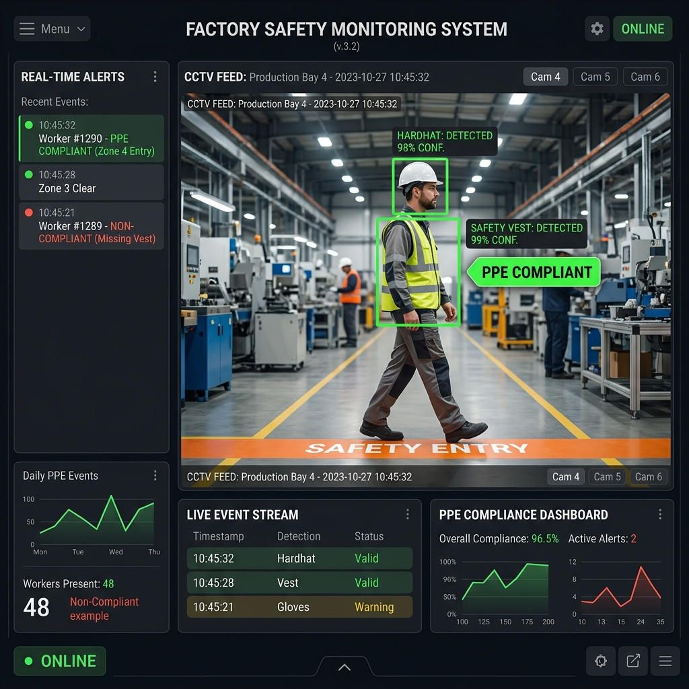

# 🏭 PPE Safety Monitoring & Machine Zone Protection

> **An AI-powered camera system that watches factory workers in real time, checks if they're wearing their safety helmet and reflective vest, and sounds a loud alarm the moment an unprotected worker steps into a dangerous machine zone.**



---

## What Does This System Do?

Imagine a tireless digital safety supervisor standing at every machine cell 24 hours a day:

| Feature | What It Means |
|---|---|
| **🎥 Live Camera Monitoring** | Connects to any USB webcam, IP camera, or existing factory CCTV and watches workers in real time |
| **🧠 AI Detection** | Custom-trained neural network identifies **People**, **Helmets**, and **Safety Vests** with **97.8% accuracy** |
| **🚧 Virtual Machine Zone** | Yellow safety borders appear on screen matching your factory floor tape — **click and drag** them to fit any machine layout |
| **🚨 Instant Loud Alarm** | A high-decibel industrial siren sounds immediately when an unprotected worker crosses into the danger zone |
| **📋 In-Camera Audit Log** | Press **E** on the camera feed to see recent violations without leaving the screen |
| **📊 Web Dashboard** | A live analytics dashboard shows shift compliance rates, hourly charts, and exportable incident reports |
| **📁 CSV Event Log** | Every incident is timestamped and saved to a spreadsheet-compatible file for OSHA/EHS audits |
| **🧪 19 Automated Tests** | Built-in test suite ensures every safety rule works correctly before deployment |

---

## 🖥️ What You Need (Prerequisites)

| Requirement | Details |
|---|---|
| **Computer** | Windows 10/11, macOS, or Linux |
| **Python** | Version 3.10 or newer ([Download Python](https://www.python.org/downloads/)) |
| **Camera** | Any USB webcam, laptop camera, or IP camera (or use the built-in demo video mode — no camera needed!) |
| **GPU (Optional)** | An NVIDIA GPU with CUDA speeds things up significantly, but the system also runs on CPU |
| **Internet** | Required only for the first run (to download the AI model) |

---

## 🚀 Quick Start — Get Running in 3 Minutes

### Step 1: Download or Clone This Repository

If you received this as a ZIP file, extract it to a folder (e.g., `C:\ppe_webcam_poc`).

If you have Git installed:
```bash
git clone <repository-url>
cd ppe_webcam_poc
```

### Step 2: Set Up the Environment

Open a terminal (PowerShell on Windows, Terminal on macOS/Linux) and navigate to the project folder.

**On Windows (PowerShell):**
```powershell
py -3 -m venv .venv
.\.venv\Scripts\Activate.ps1
python -m pip install --upgrade pip
pip install -r requirements.txt
```

> **💡 Tip:** If `py -3` doesn't work, try `python -m venv .venv` instead.

**On macOS / Linux:**
```bash
python3 -m venv .venv
source .venv/bin/activate
python -m pip install --upgrade pip
pip install -r requirements.txt
```

> **⏳ First-time install** takes 2–5 minutes (downloads AI libraries + model weights).

### Step 3: Run the System

**Option A — With a live camera:**
```bash
python ppe_webcam_poc.py
```

**Option B — With the demo video (no camera needed):**
```bash
python generate_demo_assets.py
python ppe_webcam_poc.py --camera demo_video.mp4 --anchor center --show-detections
```

**Option C — With an external USB webcam:**
```bash
# First, find your camera index:
python ppe_webcam_poc.py --list-cameras

# Then launch with it (e.g., camera index 2):
python ppe_webcam_poc.py --camera 2 --model weights/my_custom_ppe.pt
```

### Step 4: Open the Web Dashboard (Optional)

In a **second terminal window** (keep the camera running in the first):
```bash
python dashboard.py --port 8080
```
Then open your browser to: **[http://localhost:8080](http://localhost:8080)**

> **💡 Shortcut:** Press **D** in the camera window to instantly open the dashboard in your browser.

### Step 5: Run the Automated Tests

To verify everything is working correctly:
```bash
python -m pytest test_ppe.py -v
```
You should see **19 passed** — all green.

---

## 🎮 How to Use the Live Camera Window

Once the camera window is open, here's what you can do:

### On-Screen Buttons (click with your mouse)
| Button | What It Does |
|---|---|
| **📋 Events (E)** | Opens a semi-transparent panel showing recent violation incidents |
| **🌐 Dashboard (D)** | Opens the web analytics dashboard in your browser |

### Keyboard Shortcuts
| Key | Action |
|---|---|
| **E** | Toggle the Events audit drawer open/closed |
| **D** | Open the web dashboard in your browser |
| **Spacebar** | Trigger a manual test alarm (for demonstration purposes) |
| **[ and ]** | Nudge the Left Yellow Border left or right |
| **, and .** | Nudge the Right Yellow Border left or right |
| **Tab** | Switch between Dual Borders mode and Single Line mode |
| **R** | Reset borders to their default positions |
| **Q or Esc** | Quit the application |

### Drag the Safety Borders
- **Click and drag** either yellow border line directly on the video feed with your mouse
- The borders show drag handles (◀▶) that highlight in cyan when you hover over them
- This lets you align the virtual zone with the physical yellow tape on your factory floor

---

## 📂 What's in This Folder

| File / Folder | What It Is |
|---|---|
| `ppe_webcam_poc.py` | 🧠 **The main application** — runs the camera, AI detection, safety logic, and alarm system |
| `dashboard.py` | 📊 **Web dashboard** — a local website showing live violation stats and event history |
| `test_ppe.py` | ✅ **Automated tests** — 19 test cases verifying the safety logic works correctly |
| `train_custom_ppe.py` | 🏋️ **Model training script** — retrain the AI on your own factory images for better accuracy |
| `generate_demo_assets.py` | 🎬 **Demo generator** — creates a test video and sample events so you can try without a camera |
| `convert_data.py` | 🔄 **Data converter** — converts raw photos/videos into training-ready format |
| `PPE_Safety_Monitoring_Presentation.pptx` | 📽️ **Client presentation** — ready-to-present 10-slide PowerPoint deck |
| `validation_template.csv` | 📝 **Validation template** — structured form for documenting human vs. AI accuracy comparisons |
| `requirements.txt` | 📦 **Dependencies list** — Python packages needed to run the system |
| `docs/` | 📸 Screenshots and preview images |
| `weights/` | 🤖 Trained AI model files (created after training or first run) |
| `runs/` | 📈 Training metrics, accuracy charts, and confusion matrices |
| `Data/` | 🖼️ Training dataset images and labels |
| `.gitignore` | 🙈 Tells Git which large/temporary files to skip when uploading |

---

## 🤖 Using Different AI Models

### Default: Pre-trained PPE Model (Recommended for Quick Start)
```bash
python ppe_webcam_poc.py
```
This automatically downloads a PPE-trained model from Hugging Face. No setup needed.

### Your Own Custom-Trained Model (Best Accuracy)
If you've trained a custom model using `train_custom_ppe.py`:
```bash
python ppe_webcam_poc.py --model weights/my_custom_ppe.pt
```

### YOLO-World Zero-Shot (No Training Needed!)
Detects PPE items from plain English text prompts — no labeled images required:
```bash
python ppe_webcam_poc.py --model yolov8s-worldv2.pt
```

You can even customize what it looks for:
```bash
python ppe_webcam_poc.py --model yolov8s-worldv2.pt --world-classes person "hard hat" "safety vest" "no hardhat" "no safety vest"
```

### General YOLO Model (Pipeline Test Only)
Useful for testing the camera and zone logic, but **will NOT detect PPE**:
```bash
python ppe_webcam_poc.py --model yolo11n.pt
```

---

## 🏋️ Train Your Own Custom Model

Want maximum accuracy on your specific factory uniforms and lighting?

1. **Label your images** on [Roboflow](https://roboflow.com) with these 5 classes:
   `Person`, `Hardhat`, `NO-Hardhat`, `Safety Vest`, `NO-Safety Vest`

2. **Export** as YOLOv8 format and place in the `Data/` folder

3. **Run training:**
   ```bash
   python train_custom_ppe.py --data Data/Dataset/data.yaml --epochs 50 --batch 8
   ```

4. **Use the trained model:**
   ```bash
   python ppe_webcam_poc.py --model weights/my_custom_ppe.pt
   ```

---

## 🚧 Machine Zone Boundary Modes

### Mode 1: Dual Vertical Borders (Default — Recommended)
Matches factory floors where machinery is in the center with walkways on both sides:

```
 ┌──────────┬──────────────────────┬──────────┐
 │ WALKWAY  ║   MACHINE ZONE      ║ WALKWAY  │
 │  (safe)  ║   (danger zone)     ║  (safe)  │
 └──────────┴──────────────────────┴──────────┘
         25%                    75%
    Left Border            Right Border
```

```bash
python ppe_webcam_poc.py --boundary-type dual_vertical --zone-left 0.25 --zone-right 0.75
```

### Mode 2: Single Line (Legacy)
A single crossing line for simpler layouts:
```bash
python ppe_webcam_poc.py --boundary-type single_line --line-position 0.72
```

---

## ⚙️ All Command-Line Options

| Option | Default | Description |
|---|---|---|
| `--camera` | `0` | Camera index (0 = built-in, 1+ = external) or path to a video file |
| `--model` | Auto-download | Path to YOLO model weights file |
| `--conf` | `0.30` | How confident the AI must be to detect something (0.0–1.0) |
| `--person-conf` | `0.45` | Confidence threshold for person detections (filters false positives) |
| `--boundary-type` | `dual_vertical` | `dual_vertical` or `single_line` |
| `--zone-left` | `0.25` | Left border position (0.05–0.45) |
| `--zone-right` | `0.75` | Right border position (0.55–0.95) |
| `--no-audio` | Off | Disable the alarm sound |
| `--show-detections` | Off | Draw individual detection boxes for debugging |
| `--fullscreen` | Off | Open in fullscreen mode |
| `--window-width` | `1280` | Window width in pixels |
| `--window-height` | `720` | Window height in pixels |
| `--save-snapshots` | Off | Save screenshots of violation events |
| `--list-cameras` | — | List all connected cameras and exit |
| `--mirror` | Off | Mirror the image (selfie mode) |
| `--auto-log-violations` | On | Automatically log workers in zone without PPE |

---

## 📊 Understanding the Event Log (`events.csv`)

Every incident is logged with these fields:

| Column | Example | Meaning |
|---|---|---|
| `timestamp_utc` | `2026-10-22T12:34:56Z` | When it happened (UTC time) |
| `camera` | `0` | Which camera detected it |
| `track_id` | `5` | Unique worker tracking number |
| `event_type` | `PPE_NONCOMPLIANT_CROSSING` | What happened (see below) |
| `helmet_status` | `MISSING` | Was the helmet on? |
| `vest_status` | `PRESENT` | Was the vest on? |
| `overall_status` | `NONCOMPLIANT` | Overall safety verdict |

### Event Types Explained
| Event | Meaning | Alarm? |
|---|---|---|
| `PPE_COMPLIANT_CROSSING` | Worker entered zone with all PPE on | ❌ No |
| `PPE_NONCOMPLIANT_CROSSING` | Worker entered zone with missing PPE | ✅ **YES — loud siren** |
| `PPE_UNKNOWN_AT_CROSSING` | AI couldn't determine PPE status | ⚠️ Warning |

---

## 🔧 Troubleshooting

| Problem | Solution |
|---|---|
| **"Camera unavailable"** | Close other apps using the camera. Try `--camera 1` or `--camera 2` |
| **PPE always shows "UNKNOWN"** | The model may not have helmet/vest classes. Use `--show-detections` to debug. Try `--model weights/my_custom_ppe.pt` |
| **No alarm sounds** | Check your speaker/system volume. On some systems, try turning up master volume. Use `--no-audio` to disable if needed |
| **No crossing events logged** | Make sure the person fully crosses the yellow border. Feet must be visible for `foot` anchor mode. Try `--anchor center` for demos |
| **Window is too small/big** | Drag the window edges to resize, or use `--window-width 1920 --window-height 1080` or `--fullscreen` |
| **"pip install" fails** | Make sure you activated the virtual environment first (`.venv\Scripts\Activate.ps1` on Windows) |
| **Python not found** | Download Python from [python.org](https://www.python.org/downloads/). Check "Add to PATH" during install |

---

## 📈 Model Accuracy (Our Custom Training Results)

| Metric | Score | What It Means |
|---|---|---|
| **mAP@50** | **97.8%** | Overall detection accuracy across all equipment types |
| **Precision** | **91.4%** | When it says "helmet detected," it's right 91% of the time |
| **Recall** | **94.2%** | It catches 94% of all helmets and vests in view |
| **Inference Speed** | **10.8 ms** | Processes each frame in ~11 milliseconds (~90 FPS) |

The model recognizes 6 classes: `Person`, `Helmet`, `No_Helmet`, `Vest`, `No_Vest`, `BorderLine`

---

## ⚠️ Important Safety Notice

> **This is a Proof of Concept (POC) — not a certified safety device.**
>
> - It is a **monitoring and warning aid only**
> - It does **NOT** physically prevent entry or stop machinery
> - It is **NOT** a replacement for existing safety guards, interlocks, or human supervision
> - Do **NOT** connect this directly to safety-critical machinery controls
> - A production deployment requires independent validation, cybersecurity review, and qualified safety engineering

### Before Any Factory Pilot
1. Validate the AI against your specific uniforms, lighting, and camera angles
2. Run in **shadow mode** first — compare AI output against human reviewers before relying on it
3. Set acceptance thresholds with your site's safety officer
4. Test failure scenarios (camera disconnect, power loss, obstructed view)

---

## 🗂️ Repository Architecture

```
ppe_webcam_poc/
├── ppe_webcam_poc.py           ← Main real-time camera + AI pipeline
├── dashboard.py                ← Web analytics dashboard (localhost:8080)
├── test_ppe.py                 ← 19 automated unit tests
├── train_custom_ppe.py         ← Train your own model on custom images
├── generate_demo_assets.py     ← Create demo video + sample events
├── convert_data.py             ← Convert raw photos → training format
├── PPE_Safety_Monitoring_Presentation.pptx  ← Client presentation (10 slides)
├── validation_template.csv     ← Human vs. AI accuracy comparison template
├── requirements.txt            ← Python dependencies
├── .gitignore                  ← Git exclusion rules
├── docs/
│   └── dashboard_preview.jpg   ← System screenshot
├── weights/                    ← Trained model files (.pt)
├── runs/                       ← Training charts & metrics
└── Data/                       ← Training images & labels
```

---

## 📄 License

This project is a proof-of-concept demonstration. Please consult with the development team regarding licensing for production use.
